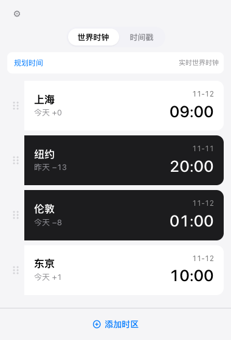
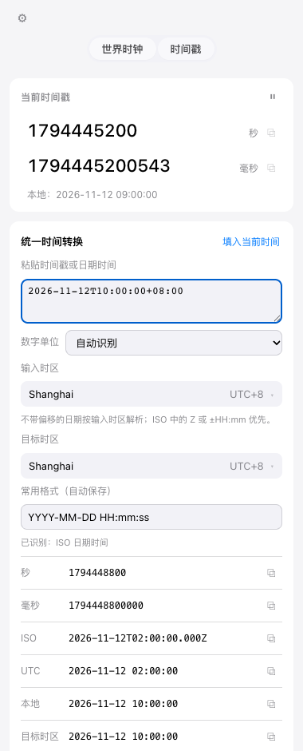
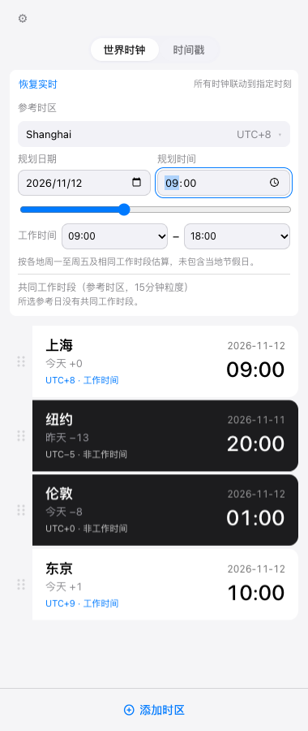

# Time Master

[](https://github.com/nilsir/time-master/actions/workflows/build.yml)

面向开发者的浏览器时间工具：统一时间转换、实时世界时钟与跨时区时间规划，支持 Chrome、Firefox 桌面扩展。

## 功能

- **统一转换**：粘贴整数时间戳、ISO 日期或所选格式的时间字符串，自动识别；数字可明确选择秒或毫秒。
- **六种结果**：秒、毫秒、ISO、UTC、本地与目标时区，一键复制。ISO 内的偏移优先；无偏移日期使用输入时区。
- **严格校验**：拒绝不存在的日期、无效时间和夏令时跳过的当地时间；重复时间提供较早、较晚两个候选。
- **常用格式**：输入或选择 Day.js 格式令牌，自动保存并在两个入口之间同步。粘贴内容不保存到存储。
- **实时世界时钟**：昼夜配色、中文城市别名、UTC 与分钟级偏移搜索、拖动排序、左滑删除。暂停当前时间戳不会冻结世界时钟。
- **时间规划**：选择参考时区、日期、时间，或拖动 15 分钟步进滑块，让所有时钟联动；可随时恢复实时。
- **工作时段**：比较各地周一至周五的工作时间，支持调整起止整点，展示参考日内共同工作时段。结束点不包含在工作时间内，不含当地节假日。
- **界面设置**：中英双语、浅色/深色/系统主题、12/24 小时制、默认标签页；支持工具栏弹窗与独立窗口。

## 截图







## 安装

1. 从 [发布页面](https://github.com/nilsir/time-master/releases) 下载 Chrome 或 Firefox 包。
2. Chrome：解压 `time-master.zip`，在 `chrome://extensions` 开启开发者模式，加载解压后的 `dist/`。
3. Firefox 桌面调试：解压 `time-master-firefox.zip`，在 `about:debugging` → 此 Firefox → 临时载入附加组件，选择 `manifest.json`。正式安装需浏览器要求的签名流程；本项目本地构建不等于已签名发布。

Chrome 最低版本为 114；Firefox 构建最低版本为 140。Firefox Android 不支持桌面独立窗口，当前未纳入实机验收。

## 开发与验证

```bash
npm ci
npm run dev               # Vite + Chrome 扩展热更新
npm test                  # 单元与构建链路回归
npm run typecheck         # TypeScript 与 Vue 类型检查
npm run build             # Chrome → dist/
npm run build:firefox     # Chrome 构建后生成 Firefox 包
npm run build:packages    # 同时生成两个最终 ZIP，并检查包内版本
npm run verify:packages   # 再次读取两个 ZIP 的 manifest 进行版本校验
npx playwright install chromium
npm run test:e2e          # 在真实加载扩展的 Chromium 中测试两个入口
```

打包需要系统 `zip`、`unzip`。E2E 使用独立的临时 Chromium 用户数据目录，不访问日常浏览器资料。多宿主时区回归可执行：

```bash
TZ=UTC npm test
TZ=Asia/Shanghai npm test
TZ=America/New_York npm test
```

## 时间与规划约定

- 自动数字识别沿用位数启发式；历史短毫秒值有歧义时，选择“毫秒”。仅接受安全整数，秒转换为毫秒后也必须在有效日期范围内。
- ISO 输出使用原生 ISO 格式，保留毫秒及扩展年份。带偏移 ISO 输入优先解析偏移；自定义格式严格匹配完整输入，方括号表示字面量。
- 日期解析和工作时段计算均在 `src/lib/time.ts`。组件不直接使用 Day.js。
- 跨日标签按目标与参考时区的日历日期比较；规划模式的参考时区可自行选择，实时模式使用本地时区。
- 共同工作时段按绝对时间每 15 分钟采样，覆盖真实的 23/25 小时夏令时日期；历史秒级偏移不提供秒粒度规划精度。
- 规划状态与数字单位选择只在当前面板保留。常用格式、目标时区和用户设置通过 `chrome.storage.sync` 保存；窗口边界使用 `chrome.storage.local`。
- Firefox 的窗口边界由独立页面低频检查及尺寸变化事件保存；关闭页面时的最终异步写入属于尽力保存。

## 构建与发布

分支推送与 PR 执行单测、类型检查、双浏览器构建、ZIP 版本校验及 Chromium E2E；普通分支不调用发布流程。

仅 `main` 推送进入语义化发布：先确定新版本，由 npm 插件更新 `package.json`，再运行本地 `prepare` 插件重新构建、清理旧文件、打包并校验两个 ZIP 的版本，之后创建 Release 和版本提交。

`feat:` 触发 minor，`fix:` 触发 patch，`BREAKING CHANGE` 触发 major；`docs:` / `chore:` 不自动生成新版本。本次三个阶段作为一次功能交付，不提前写入假定的发布版本。

## 已知验证边界

Chromium 自动化覆盖工具栏页面、独立页面、后台开窗、同步、复制和规划；Firefox 通过打包与静态检查，仍需真实 Firefox 手工回归。无来源标识的存储事件存在同值歧义：在有限的旧写入回声识别窗口内，其他页面恰好写入相同旧值无法被严格区分。
